# rusty-sunspec-collector

[](https://www.rust-lang.org/) [](#license) [](https://imrans110.github.io/rusty-sunspec-collector/) [](https://github.com/imrans110/rusty-sunspec-collector/actions/workflows/ci.yml)

An edge service, written in Rust, that finds SunSpec devices (inverters, meters, batteries) on
Modbus TCP, walks each device's SunSpec model chain, polls every model on a fixed schedule, and
decodes the points at the edge using the official SunSpec model definitions. Samples are buffered
in SQLite on local disk and published to Kafka as Avro single-object records keyed by device.
Delivery is at-least-once: a buffered sample is deleted only after Kafka acknowledges it. The
buffer is bounded by row count and age, so during a very long outage the oldest samples are
dropped (and counted) instead of growing the buffer without limit.



## Features

- **Device discovery**: scan an IPv4 CIDR subnet (TCP probe on the Modbus port, bounded
  concurrency, per-host timeout) or use a static list of hosts (IP addresses or hostnames). Subnet
  mode rescans periodically and starts pollers for new hosts.
- **Gateway support**: devices are keyed by host and unit ID, so every unit behind one gateway IP
  is polled.
- **Model chain walk**: the collector finds the `SunS` marker (configured base address first, then
  40000, 0 and 50000) and reads model headers one at a time until the end marker. Models are
  rediscovered on every reconnect.
- **Per-device supervision**: each device runs in its own task (connect, discover, poll). A failed
  session is retried with exponential backoff (capped at 60 s, with per-device jitter) until
  shutdown, so devices that are offline at startup are picked up when they come online.
- **Stall detection**: a session with no successful read for `poller.stall_timeout_ms` (default
  the larger of 10 poll intervals and 30 s) is aborted and restarted.
- **Polling profiles**: read slow-changing models less often (`poller.model_intervals_s`, e.g.
  nameplate hourly), choose which models are polled (`include_models`, `exclude_models`), and
  override the poll interval, request timeout, base address and batch size per static device.
- **Edge decoding**: bundled official SunSpec definitions for models 1, 101-103, 111-113, 120-124,
  160, 201-204, 701-713 (IEEE 1547-2018 DER) and 802. Scale factors are applied, "not implemented"
  values become null, strings are trimmed, and repeating groups are named `group[i].Point`
  (nested ones too, e.g. `Crv[1].Pt[2].V`). Raw registers are kept alongside.
- **Durable buffer**: SQLite in WAL mode. Samples are written in transactions of up to 256 rows.
  Retention drops the oldest rows beyond `buffer.max_rows` or older than `buffer.max_age_s`, and
  every drop is counted in a metric.
- **At-least-once uplink**: one Kafka record per sample, `acks=all`, idempotent producer, zstd
  compression. Only acknowledged rows are deleted; the rest stay buffered and are retried first.
- **Graceful shutdown** on SIGINT or SIGTERM: pollers stop, queued samples are written to the
  buffer, and the uplink keeps draining for up to `buffer.shutdown_drain_timeout_ms`.
- **Observability**: Prometheus metrics and a `/healthz` endpoint on one port, structured logs
  (text or JSON), and a systemd watchdog that is pinged only while the pipeline is healthy.
- **Strict configuration**: TOML or JSON file plus `SUNSPEC_*` environment variables. Unknown keys
  and invalid values stop the collector at startup instead of falling back to defaults.
- **Simulator included**: `sunspec-sim` serves SunSpec register maps over Modbus TCP, so the test
  suite and the Docker stack run without hardware.

## Install

Each [release](https://github.com/imrans110/rusty-sunspec-collector/releases) has prebuilt Linux
binaries for x86_64 and aarch64 and multi-arch Docker images. The binaries need glibc 2.18 or newer
and nothing else (OpenSSL, librdkafka, SQLite and zstd are linked in); the systemd unit needs
systemd 235 or newer (Debian 10+, Ubuntu 18.04+, RHEL 8+, Raspberry Pi OS 10+).

On a machine with systemd, install the latest release:

```sh
curl -fsSL https://github.com/imrans110/rusty-sunspec-collector/releases/latest/download/install.sh | sudo sh
```

The script checks the archive against the release's `SHA256SUMS` and installs `collector-app` and
`sunspec-sim` in `/usr/local/bin`, the systemd unit, and `/etc/sunspec-collector.env` (kept on
upgrades). Set your devices and Kafka brokers there, then run
`sudo systemctl enable --now sunspec-collector`. To read the script before running it, download it
and run `sudo sh install.sh`; `SUNSPEC_VERSION=0.2.0` picks a specific release.

With Docker:

```sh
docker run -d --name sunspec-collector -p 9090:9090 -v sunspec-data:/app/data \
  -e SUNSPEC_STATIC_DEVICES=192.168.1.50:1 -e SUNSPEC_KAFKA_BROKERS=kafka.internal:9092 \
  ghcr.io/imrans110/sunspec-collector:latest
```

`ghcr.io/imrans110/sunspec-simulator` serves simulated devices for trying it without hardware. To
build from source instead, see [Run without Docker](#run-without-docker) and
[docs/build.md](docs/build.md).

## Quick start

The Docker Compose stack runs Kafka, a simulator with two units behind one address, the collector
and Prometheus. No hardware is needed.

```sh
docker compose up --build
```

Then:

```sh
# Health: 200 and a JSON body while ingest and the uplink are running
curl localhost:9090/healthz
# {"healthy":true,"ingest_age_s":0.7,"uplink_age_s":0.3,"devices_up":2,"devices_total":2}

# Prometheus metrics from the collector
curl -s localhost:9090/metrics | grep '^sunspec_'

# Record keys on the topic (values are binary Avro)
docker compose exec kafka /opt/kafka/bin/kafka-console-consumer.sh \
  --bootstrap-server localhost:9092 --topic sunspec.telemetry --from-beginning \
  --property print.key=true --property print.value=false
```

- Prometheus UI: <http://localhost:9091>
- Kafka from the host: `localhost:29092`, topic `sunspec.telemetry`

`docker compose down -v` stops the stack and removes its volumes (Kafka data and the collector's
buffer).

## Run without Docker

Start the simulator with two units, then point the collector at it:

```sh
cargo run -p sunspec-sim -- --bind 127.0.0.1:1502 --units 1,2

SUNSPEC_STATIC_DEVICES=127.0.0.1:1,127.0.0.1:2 SUNSPEC_PORT=1502 \
  cargo run -p collector-app
```

Without `SUNSPEC_KAFKA_BROKERS` the collector does not connect to Kafka: it logs each record's key
and size at debug level instead of publishing it (`RUST_LOG=info,avro_kafka=debug` to see them).
To publish to the Compose Kafka broker, add `SUNSPEC_KAFKA_BROKERS=localhost:29092`.

Simulator flags: `--bind ADDR:PORT` (default `0.0.0.0:1502`), `--units 1,2` (default `1`),
`--models 1,103,120,160:48` (the default; a bare ID uses the bundled definition's length, `id:len`
sets it), `--base 40000`. It serves holding registers (function 0x03), rejects reads of more than
125 registers, and changes power, current, voltage, frequency, energy and state values in model 103
over time.

## Kafka record format

- **One record per sample** (one model read from one device).
- **Key**: the device key `host/unit_id`, for example `192.168.1.20/1`. All records from a device
  go to the same partition.
- **Value**: Avro single-object encoding: the bytes `C3 01`, the schema's 8-byte CRC-64-AVRO
  fingerprint (little-endian), then the Avro binary datum.
- **Headers**: `content-type: application/avro; encoding=single-object` and
  `schema-fingerprint: <16 hex characters>`.
- **Schema** `com.rusty.sunspec.v2.SunspecSample`: `device_key`, `ip`, `unit_id`, `model_id`,
  `model_name` (official SunSpec name such as `inverter_three_phase`, or `model_<id>`), `start`
  (register address of the model header), `collected_at_ms` (timestamp-millis), `points` (map of
  point name to null, double, long or string) and `registers` (raw, including the two header
  registers).
- Models without a bundled definition have an empty `points` map and raw `registers` only.

The schema is in [`crates/avro-kafka/schemas/sunspec_sample.avsc`](crates/avro-kafka/schemas/sunspec_sample.avsc);
`collector-app --print-schema` prints it. Rust consumers can use `avro_kafka::decode`.

Because delivery is at-least-once, consumers should deduplicate on
`(device_key, model_id, collected_at_ms)`.

**Breaking change:** earlier versions published one Avro container file per message, mixing
devices, with the schema embedded, no key, raw registers only and different model names (for
example `three_phase_inverter`). Consumers of the old format need to be updated. See
[CHANGELOG.md](CHANGELOG.md).

## Configuration

Settings load in this order, last one wins: built-in defaults, then a config file
(`--config PATH` or `SUNSPEC_CONFIG`; `.json` is read as JSON, anything else as TOML), then
`SUNSPEC_*` environment variables. Unknown keys and invalid values fail at startup, for example
`modbus.max_batch_size` above 125, or `kafka.acks` set to 0 or 1 while idempotence is on.

The settings most deployments change:

| File key | Env var | Default |
|---|---|---|
| `discovery.static_devices` | `SUNSPEC_STATIC_DEVICES` (`host[:unit],...`) | none (subnet scan) |
| `discovery.subnet` | `SUNSPEC_SUBNET` | `192.168.1.0/24` |
| `discovery.port` / `modbus.port` | `SUNSPEC_PORT` | `502` |
| `poller.poll_interval_ms` | `SUNSPEC_POLL_INTERVAL_MS` | `1000` |
| `poller.model_intervals_s` | `SUNSPEC_MODEL_INTERVALS_S` (`1=3600,120=3600`) | none (every model every cycle) |
| `buffer.path` | `SUNSPEC_BUFFER_PATH` | `sunspec-buffer.sqlite` in the working directory (`/app/data` in Docker) |
| `kafka.brokers` | `SUNSPEC_KAFKA_BROKERS` | none (records are only logged) |
| `kafka.topic` | `SUNSPEC_KAFKA_TOPIC` | `sunspec.telemetry` |
| `kafka.security_protocol` | `SUNSPEC_KAFKA_SECURITY_PROTOCOL` | `plaintext` (`ssl`, `sasl_plaintext`, `sasl_ssl`) |

TLS (including mutual TLS) and SASL PLAIN or SCRAM authentication are configured with the
`kafka.ssl_*` and `kafka.sasl_*` keys. Passwords can be read from files (`*_password_file`), which
works with Docker secrets and systemd credentials; the compose stack authenticates this way.

Static devices in a config file can override the poll interval, request timeout, base address,
batch size and model selection per device; see
[Polling profiles](docs/configuration.md#polling-profiles).

Logging is set with `RUST_LOG` (default `info`) and `SUNSPEC_LOG_FORMAT=text|json`.

The full reference is in [docs/configuration.md](docs/configuration.md). Starter files:
[docs/config.example.toml](docs/config.example.toml) and
[docs/sunspec-collector.env](docs/sunspec-collector.env).

## Observability

The collector serves two endpoints on `metrics.port` (default 9090). If the port cannot be bound,
the collector stops at startup with `bind metrics port <port>`.

- `/metrics`: Prometheus text format. `*_seconds` metrics are histograms.
- `/healthz`: 200 while ingest and the uplink have checked in within the last 120 s, otherwise
  503, with a JSON body. A device being offline does not make the collector unhealthy.

Metrics worth alerting on (per-device metrics have a `device="host/unit"` label):

| Metric | Meaning |
|---|---|
| `sunspec_device_up` | 1 while a device is being polled successfully; 0 from the moment its poller starts, so a device that never answers shows 0 |
| `sunspec_poller_stalls_total` | sessions restarted by stall detection |
| `sunspec_poll_errors_total{kind}` | failed reads by kind |
| `sunspec_buffer_rows`, `sunspec_buffer_oldest_age_seconds` | buffer backlog |
| `sunspec_buffer_dropped_total{reason}` | rows dropped without being published |
| `sunspec_uplink_records_total`, `sunspec_uplink_errors_total` | records acknowledged / not acknowledged by Kafka |

The full metric list and suggested alerts are in [docs/ops.md](docs/ops.md).

## Deployment

- **Docker**: the `Dockerfile` builds two targets, `collector` (default) and `simulator`
  (`docker build --target simulator`). Images run as the non-root user `collector`. The collector
  runs in `/app/data`, so the default buffer is `/app/data/sunspec-buffer.sqlite`; mount a volume
  at `/app/data` to keep it. A `buffer.path` from a config file or `SUNSPEC_BUFFER_PATH` is
  respected. The `HEALTHCHECK` calls `http://localhost:${SUNSPEC_METRICS_PORT:-9090}/healthz`.
- **systemd**: [docs/sunspec-collector.service](docs/sunspec-collector.service) runs the binary
  from `/usr/local/bin/collector-app` with `Type=notify`, a 30 s watchdog, a dynamic unprivileged
  user and `/var/lib/sunspec-collector` as its state directory. Settings come from
  `/etc/sunspec-collector.env` (start from [docs/sunspec-collector.env](docs/sunspec-collector.env)).
- **Releases**: `.github/workflows/release.yml` cross-compiles x86_64 and aarch64 binaries with
  `cross` and `docker/Dockerfile.cross`, packages them as archives and as multi-arch images, and
  tests the install script under systemd. Pushing a `v*` tag publishes the release.

Step-by-step instructions: [docs/build.md](docs/build.md) (building and packaging),
[docs/ops.md](docs/ops.md) (running, monitoring, troubleshooting) and
[docs/buffer_maintenance.md](docs/buffer_maintenance.md) (the SQLite buffer). The documentation
site is at <https://imrans110.github.io/rusty-sunspec-collector/>.

## Workspace layout

| Crate | Purpose |
|---|---|
| `crates/types` | Shared data types (`DeviceIdentity`, `Sample`, `PointValue`); depends only on `serde` |
| `crates/discovery` | Subnet scan (TCP probe with bounded concurrency) and static device lists |
| `crates/modbus-client` | Modbus TCP client: splits reads at 125 registers, retries with backoff, reconnects after transport errors |
| `crates/sunspec-parser` | Bundled official SunSpec model definitions, model names and point decoding |
| `crates/poller-actor` | Per-device lifecycle: supervision, model chain discovery, polling, stall detection, per-device metrics |
| `crates/buffer` | SQLite store-and-forward queue |
| `crates/avro-kafka` | Avro schema, single-object encoding and decoding, Kafka publisher |
| `crates/collector-app` | The `collector-app` binary and library: config, orchestration, ingest, uplink, retention, health and metrics endpoints, systemd integration |
| `crates/sunspec-sim` | SunSpec Modbus TCP simulator (library and `sunspec-sim` binary) used by the tests and Docker Compose |

Documentation lives in `docs/` and is built with mdBook.

## Development

Prerequisites:

- Rust 1.88 or newer (the workspace MSRV)
- cmake, a C toolchain and pkg-config (librdkafka is built from source)
- OpenSSL headers (`libssl-dev`) and libcurl headers (`libcurl4-openssl-dev`); librdkafka 2.12
  needs both to compile. On macOS, `brew install cmake` is usually enough.

SQLite and zstd are bundled.

```sh
cargo build --workspace
cargo test --workspace
```

The tests run against the in-process simulator and need no hardware or Kafka. The Kafka
integration tests are ignored by default; with the Compose stack running:

```sh
SUNSPEC_KAFKA_BROKERS=localhost:29092 \
  cargo test -p avro-kafka --test kafka_integration_tests -- --ignored
```

CI (`.github/workflows/ci.yml`) runs on every pull request and every push to `main`:

- `cargo fmt --all -- --check`
- `cargo clippy --all-targets --workspace`, `cargo build --workspace` and `cargo test --workspace`,
  all with `RUSTFLAGS=-Dwarnings`
- `cargo audit`
- a Docker end-to-end job: builds both images, starts Kafka, the simulator and the collector,
  waits for `/healthz`, checks that records reach Kafka keyed per device and decode, and checks
  that the collector exits 0 on SIGTERM

A separate workflow cross-compiles the aarch64 binary on pushes to `main` and when the cross
build files change. See [docs/DEVELOPER_GUIDE.md](docs/DEVELOPER_GUIDE.md) for details.

## Limitations

- Kafka authentication is limited to SASL PLAIN and SCRAM (no Kerberos or OAuth), and rotated
  certificates are picked up on restart.
- No Schema Registry integration; records use fingerprint-based single-object encoding instead.
- Point metadata (units, labels) is not in the payload; consumers look it up by model and point
  name in the bundled definitions.
- No configuration reload (SIGHUP).
- Enum and bitfield points are published as integers, not expanded to names.
- Delivery is at-least-once, so duplicates are possible after a crash.

## Status

The collector, buffer, uplink, simulator and deployment files are implemented and covered by the
test suite and the CI end-to-end job. Binaries and images are published as GitHub releases; the
crates are not published to crates.io. Open items are
listed under [Limitations](#limitations); changes are recorded in [CHANGELOG.md](CHANGELOG.md).

## Contributing

Issues and pull requests are welcome. See [CONTRIBUTING.md](CONTRIBUTING.md) for the checks to
run before opening a PR. Keep the `types` crate light (serde only) and avoid adding heavy
dependencies to shared crates.

## License

Dual-licensed under MIT ([LICENSE-MIT](LICENSE-MIT)) or Apache-2.0
([LICENSE-APACHE](LICENSE-APACHE)), at your option.
