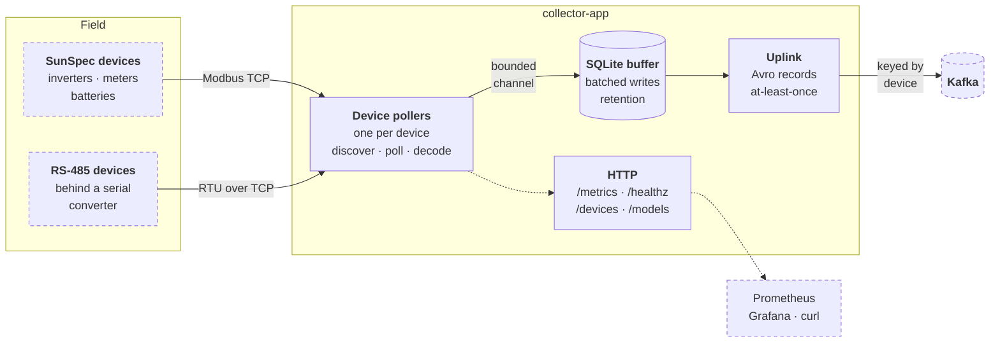

# Rusty SunSpec Collector

Rusty SunSpec Collector is an edge service written in Rust. It finds SunSpec devices (inverters,
meters, batteries) on Modbus TCP, walks each device's SunSpec model chain, polls every model on a
fixed schedule and decodes the points at the edge using the official SunSpec model definitions.
Samples are buffered in SQLite on local disk and published to Kafka as Avro single-object
records keyed by device.

Delivery is at-least-once: a buffered sample is deleted only after Kafka acknowledges it. The
buffer is bounded by row count and age, so during a very long outage the oldest samples are
dropped (and counted) instead of growing the buffer without limit.

The project is a Cargo workspace of nine crates, including `sunspec-sim`, a SunSpec Modbus TCP
simulator used by the tests and the Docker Compose stack.

---

## How data flows

1. **Device set.** Either a static list of hosts (`discovery.static_devices`) or a subnet scan
   (`discovery.subnet`, rescanned every `discovery.rescan_interval_s`). Each device is identified
   by host and Modbus unit ID, so every unit behind a gateway is polled.
2. **Per-device poller.** Each device runs in its own supervised task. A session connects, finds
   the `SunS` marker (configured base address first, then 40000, 0 and 50000), reads the model
   headers one at a time until the end marker, and then reads and decodes every model once per
   poll interval (or less often, for models given a slower interval in a polling profile). A failed or stalled session is restarted with exponential backoff, capped at
   60 s.
3. **Channel and ingest.** Samples go through a bounded channel to the ingest task, which writes
   them to SQLite in transactions of up to 256 rows. If the channel stays full for a poll
   interval, the sample is dropped and counted; polling never blocks.
4. **Buffer.** SQLite in WAL mode. A retention task runs every 10 s and drops rows older than
   `buffer.max_age_s` (7 days) or beyond `buffer.max_rows` (1,000,000).
5. **Uplink.** The uplink reads the oldest rows in batches, publishes one Kafka record per sample
   and deletes only the rows Kafka acknowledged. Undelivered rows stay and are retried first.
6. **Shutdown.** On SIGINT or SIGTERM the pollers stop, ingest writes everything still queued, and
   the uplink keeps draining for up to `buffer.shutdown_drain_timeout_ms` (5 s). Rows that are
   still buffered are sent after the next start.

Each Kafka record is keyed by `host/unit_id` and carries the device, model ID and name, the read
time, the decoded points and the raw registers. Consumers can deduplicate on
`(device_key, model_id, collected_at_ms)`. The record format is described in the
[README](https://github.com/imrans110/rusty-sunspec-collector#kafka-record-format) and the
[Avro schema](https://github.com/imrans110/rusty-sunspec-collector/blob/main/crates/avro-kafka/schemas/sunspec_sample.avsc);
`collector-app --print-schema` prints the schema.

---

## Quick start

Try it in a few minutes with simulated devices: see [Quick start](getting-started/quickstart.md).

## Where to go next

| Section | Pages |
|---------|-------|
| Get started | [Quick start](getting-started/quickstart.md) with simulated devices; [Deployment](getting-started/deployment.md) with Docker or systemd, shutdown and logs |
| Guides | [Securing the Kafka connection](guides/kafka-security.md), [Serial devices through a converter](guides/serial-devices.md), [Polling profiles](guides/polling-profiles.md), [Probing a device](guides/probing-a-device.md), [Verifying a release](guides/verifying-a-release.md), [Monitoring and alerts](guides/monitoring.md), [Buffer maintenance](buffer_maintenance.md), [Troubleshooting](guides/troubleshooting.md), [Upgrade notes](guides/upgrading.md) |
| Reference | [Configuration](configuration.md), [Command-line options](reference/cli.md), [HTTP endpoints](reference/http-endpoints.md), [Metrics](reference/metrics.md), [Record format](reference/record-format.md), [Supported SunSpec models](reference/models/README.md) |
| How it works | [Architecture](ARCHITECTURE.md): crates, tasks, data flow and design decisions |
| Contributing | [Developer Guide](DEVELOPER_GUIDE.md), [Building & Packaging](build.md), [Fuzzing](contributing/fuzzing.md) |
| Project | [Changelog](project/changelog.md), [Design Plan](plan.md), [Code Review & Audit](CODE_REVIEW.md) |

---

## Known limitations

- Kafka authentication is limited to SASL PLAIN and SCRAM (no Kerberos or OAuth).
- No Schema Registry integration; records use fingerprint-based single-object encoding.
- Point units and descriptions are not in each record; they are in the model catalog
  (`collector-app --print-models`, `/models`).
- No configuration reload.
- Delivery is at-least-once, so duplicates are possible after a crash.

---

## License

Dual-licensed under MIT or Apache-2.0.
